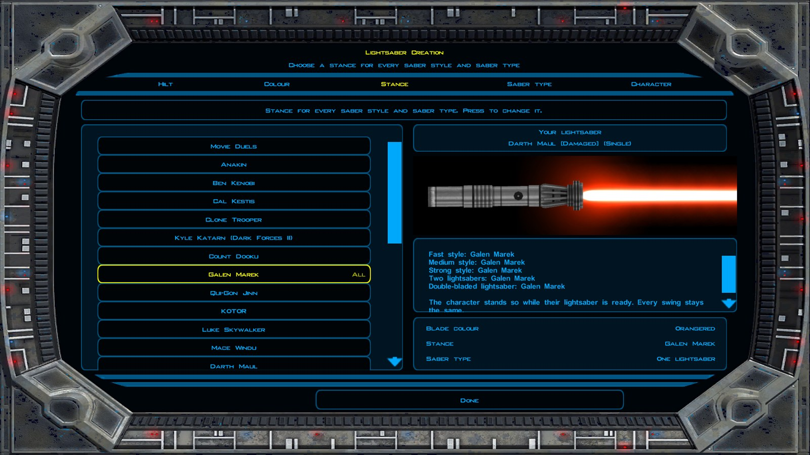
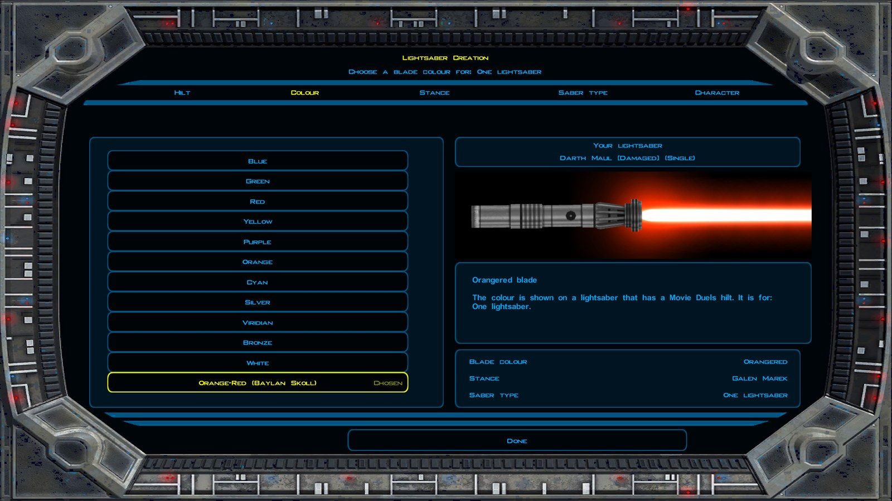
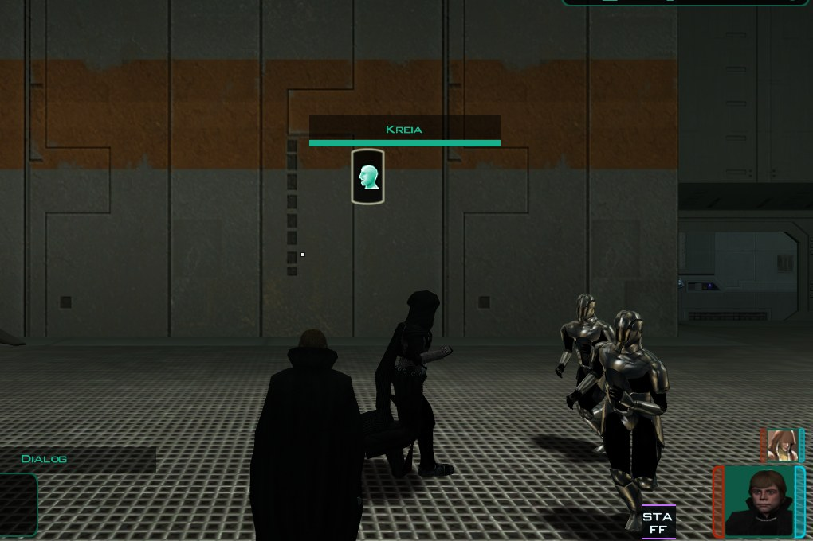
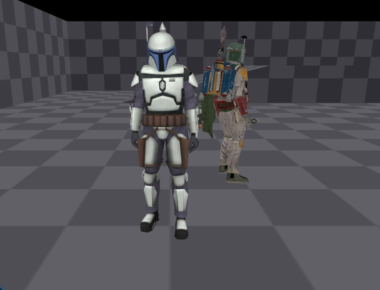

# KJK Movie Duels Mod

This mod brings Movie Duels to [KJK](https://github.com/kjk-engine/kjk), the fan engine made by reclaimterrain. KJK plays the worlds of Star Wars: Knights of the Old Republic with the movement and lightsaber combat of Star Wars Jedi Knight: Jedi Academy. This mod is built on KJK and would not exist without it. The mod adds Movie Duels' lightsaber creation, fighting stances, player models and Force powers. It works in the KOTOR 1 and the KOTOR 2 campaign.

No game files come with this mod. It reads KOTOR, Jedi Academy and Movie Duels from your own installs and never changes them.

## Download

Download [KJK-Movie-Duels-Mod.zip](https://github.com/philippberk3l-ops/kjk-movie-duels-mod/releases/latest/download/KJK-Movie-Duels-Mod.zip) (35 MB) from the [latest release](https://github.com/philippberk3l-ops/kjk-movie-duels-mod/releases/latest). Unpack it and run `Install.bat`. The `README.txt` inside the zip explains every step, including the Steam Deck and Linux.

### The installer is open too

The installer scripts in the zip are in this repository, byte for byte, so you can read them before you run anything: [`installer/`](installer). `Install.bat` only starts [`install.ps1`](installer/install.ps1) with PowerShell. That script looks for your games through Steam's and GOG's usual registry entries, and only reads them. It then copies `kjk.exe` and the readme into `%LOCALAPPDATA%\Programs\KJK`, keeps any older `kjk.exe` there as a backup, and makes a desktop and a Start menu shortcut. It downloads nothing, changes no game files and needs no administrator rights. On the Steam Deck and Linux, [`install.sh`](installer/install.sh) does the same.

You can also skip the installer. Unpack the zip anywhere and start `kjk.exe`. On its first start, KJK's own setup finds your games or asks where they are.

`kjk.exe` is not digitally signed, so Windows may show "Windows protected your PC" the first time. Choose "More info", then "Run anyway".

## What you need

- Windows 10 or 11, 64-bit, or a Steam Deck or Linux PC with Steam's Proton.
- On Windows, the Microsoft Visual C++ Redistributable for Visual Studio 2015 to 2022 (x64). Movie Duels needs it too, so if Movie Duels runs, you already have it. If KJK reports that `VCRUNTIME140.dll` is missing, install it from [Microsoft](https://aka.ms/vs/17/release/vc_redist.x64.exe). Proton on the Steam Deck and on Linux already includes it.
- Star Wars: Knights of the Old Republic II. KJK draws its menus and the Lightsaber Creation screen from it.
- Star Wars Jedi Knight: Jedi Academy. KJK takes its movement, lightsaber combat and the Force from it.
- Movie Duels, installed into Jedi Academy's `GameData\MD` folder.
- Star Wars: Knights of the Old Republic, to play the KOTOR 1 campaign.

## What the mod adds

### Lightsaber Creation

A screen in the style of Movie Duels' Lightsaber Creation menu lets each party member forge their own lightsaber. A character can take any Movie Duels hilt, one of 11 blade colours, and a Movie Duels fighting style for each of five stance slots. The slots are the fast, medium and strong styles, two lightsabers, and a double-bladed lightsaber. Each companion keeps their own hilts, colours and stances. A preview shows the hilt with its blade lit before you choose it.

### Stances

The mod offers 27 Movie Duels stances. Among them are Darth Vader, Luke Skywalker, Obi-Wan Kenobi, Count Dooku, Darth Maul, Yoda, Mace Windu, Kylo Ren, Rey, Cal Kestis, Galen Marek and General Grievous. A character blends from one stance into the next over about a quarter of a second. A character also turns their wrist so that the blade does not pass through their own body.

### Player models

The Player model page draws your own character or any companion as another model. You can choose one of the campaign's player faces, or any character of Movie Duels' character select, era by era. A companion keeps their model through area changes and saves. Armour and helmets are drawn solid, as in Movie Duels. A Movie Duels character holds KOTOR's blasters as Jedi Academy's own characters hold theirs, with the barrel along the forearm.

### Force powers

Eight Movie Duels Force powers join the game: Force Blast, Force Repulse, Force Destruction, Electric Judgment, Force Projection, Deadly Sight, Force Grasp and Force Sense. They are chosen on a power wheel. Hold G, or LB and RT together on a gamepad, to open it. Companions cast these powers in fights too.

## Steam Deck and Linux

The mod installs and runs on the Steam Deck and on Linux, through Steam's Proton. Windows' `Install.bat` cannot run inside a Proton prefix, so the zip also has a Linux installer, `install.sh`.

1. Switch the Steam Deck to Desktop Mode and unpack the zip.
2. Open the folder in the file manager, right-click an empty spot and choose "Open Terminal Here".
3. Type `bash install.sh` and press Enter. The installer finds KOTOR, KOTOR 2, Jedi Academy and Movie Duels in every Steam library, including one on a microSD card.
4. In Steam, add `kjk.exe` from the installed folder as a non-Steam game. In its Properties, under Compatibility, force Proton Experimental or the newest Proton.
5. Start it from your library. It then shows in Game Mode too.

On the first start, KJK asks where your games are. Under Proton, your Linux folders are on drive Z, and the installer prints the exact folders to choose. To uninstall, run `bash install.sh --uninstall` in the unpacked folder.

## Credits

### Star Wars: Movie Duels

Everything this mod shows from Movie Duels was made by the people below. That covers the lightsaber hilts, the blades, the fighting stances and their animations, the player models, the sounds and the Force power effects. This mod reads their files from your own Movie Duels install and ships none of them. Please download [Star Wars: Movie Duels](https://www.moddb.com/mods/movie-duels) from its makers, and thank them for it.

Movie Duels is made by the Movie Duels Team, and was first created by Wector. The development team, as Movie Duels' own readme lists it:

| Member | Role |
|---|---|
| Mike7704 | Leader, coder, menus, scripter |
| Chloe | Texture artist |
| GP | Mapper, texture artist |
| Grimbord | Modeller |
| Jace Solaris | Coder |
| LangZ | Sound editor |
| Lwkill | Mapper, scripter |
| MasterJin | Mapper |
| Mikcz | Mapper, modeller |
| RealygirlLP | Translator (German) |
| Tompa9 | Modeller, scripter, translator (Czech) |
| Valzhar | Coder |
| WC3 Tutorial | Animator |
| Yeyo JK | Texture artist |
| Zinney | Beta tester |

Movie Duels also brings together the work of many artists of the Jedi Academy community. The lightsaber hilt collection is by Plasma. The blades come from the SFX Sabers packs by Kalamaray, Scarlett and Razor Ace, the Movie Battles II team and Zinney. The player models are by many modellers, among them HapSlash, DT85, Scerendo, Tompa9, Grimbord, MIKCZ and AshuraDX. Each model, hilt and effect is credited to its authors in Movie Duels' `ReadMe\ReadMe_Credits.txt`, in your Movie Duels folder.

### The games

KJK plays these games from the copies you own:

- Star Wars: Knights of the Old Republic, by BioWare and LucasArts.
- Star Wars: Knights of the Old Republic II: The Sith Lords, by Obsidian Entertainment and LucasArts.
- Star Wars Jedi Knight: Jedi Academy, by Raven Software and LucasArts.

### KJK

[KJK](https://github.com/kjk-engine/kjk) is made by **reclaimterrain**, who created it and wrote nearly all of it, with contributions from **Superd22**. KJK is what makes this mod possible. It is a complete fan engine that plays KOTOR, KOTOR II and Jedi Academy from your own copies, with KOTOR's worlds, story and menus and Jedi Academy's movement and lightsaber combat. Its co-op and its save system come from KJK too.

This mod is built on KJK v0.17.0, with Movie Duels' features added on top. Thank you to reclaimterrain for KJK and for releasing it under the MIT License, which lets mods like this one be shared. For KJK itself, its newest versions and its own features, see [KJK's releases](https://github.com/kjk-engine/kjk/releases). This mod is not an official KJK release, and its bugs are not KJK's. Please report problems with the mod here, not to KJK.

To understand how the original engines behave, KJK's authors read the open-source projects [OpenJK](https://github.com/JACoders/OpenJK), [reone](https://github.com/seedhartha/reone) and [xoreos](https://github.com/xoreos/xoreos). No code from them is included. `NOTICE.txt` says more.

## Licence

KJK is under the MIT License. See `LICENSE.txt` and `NOTICE.txt`. Star Wars, Knights of the Old Republic and Jedi Academy are trademarks of their respective owners. This mod is not affiliated with or endorsed by them.
