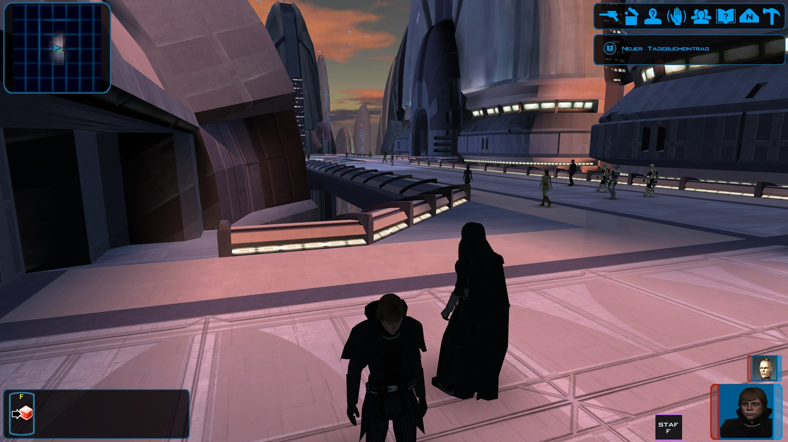
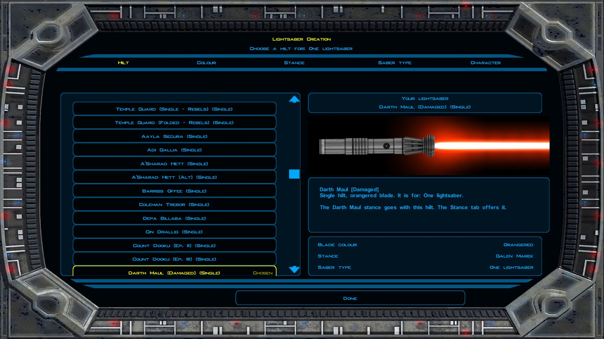
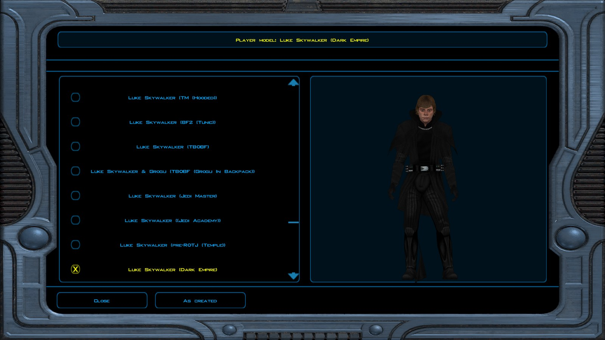

# KJK Movie Duels Mod

This mod brings Movie Duels to KJK. KJK plays the worlds of Star Wars: Knights of the Old Republic with the movement and lightsaber combat of Star Wars Jedi Knight: Jedi Academy. The mod adds Movie Duels' lightsaber creation, fighting stances, player models and Force powers. It works in the KOTOR 1 and the KOTOR 2 campaign.

No game files come with this mod. It reads KOTOR, Jedi Academy and Movie Duels from your own installs and never changes them.

## Download

Download [KJK-Movie-Duels-Mod.zip](https://github.com/philippberk3l-ops/kjk-movie-duels-mod/releases/latest/download/KJK-Movie-Duels-Mod.zip) (43 MB) from the [latest release](https://github.com/philippberk3l-ops/kjk-movie-duels-mod/releases/latest). Unpack it and run `Install.bat`. The `README.txt` inside the zip explains every step, including the Steam Deck and Linux.

## What you need

- Windows 10 or 11, 64-bit, or a Steam Deck or Linux PC with Steam's Proton.
- Star Wars: Knights of the Old Republic II. KJK draws its menus and the Lightsaber Creation screen from it.
- Star Wars Jedi Knight: Jedi Academy. KJK takes its movement, lightsaber combat and the Force from it.
- Movie Duels, installed into Jedi Academy's `GameData\MD` folder.
- Star Wars: Knights of the Old Republic, to play the KOTOR 1 campaign.

## What the mod adds

### Lightsaber Creation

A screen in the style of Movie Duels' Lightsaber Creation menu lets each party member forge their own lightsaber. A character can take any Movie Duels hilt, one of 11 blade colours, and a Movie Duels fighting style for each of five stance slots. The slots are the fast, medium and strong styles, two lightsabers, and a double-bladed lightsaber. Each companion keeps their own hilts, colours and stances. A preview shows the hilt with its blade lit before you choose it.

### Stances

The mod offers 27 Movie Duels stances. Among them are Darth Vader, Luke Skywalker, Obi-Wan Kenobi, Count Dooku, Darth Maul, Yoda, Mace Windu, Kylo Ren, Rey, Cal Kestis, Galen Marek and General Grievous. A character blends from one stance into the next over about a quarter of a second. A character also turns their wrist so that the blade does not pass through their own body.

### Player models

The Player model page draws your own character or any companion as another model. You can choose one of the campaign's player faces, or any character of Movie Duels' character select, era by era. A companion keeps their model through area changes and saves. Armour and helmets are drawn solid, as in Movie Duels. A Movie Duels character holds KOTOR's blasters as Jedi Academy's own characters hold theirs, with the barrel along the forearm.

### Force powers

Eight Movie Duels Force powers join the game: Force Blast, Force Repulse, Force Destruction, Electric Judgment, Force Projection, Deadly Sight, Force Grasp and Force Sense. They are chosen on a power wheel. Hold G, or LB and RT together on a gamepad, to open it. Companions cast these powers in fights too.

## Steam Deck and Linux

The mod installs and runs on the Steam Deck and on Linux, through Steam's Proton. Windows' `Install.bat` cannot run inside a Proton prefix, so the zip also has a Linux installer, `install.sh`.

1. Switch the Steam Deck to Desktop Mode and unpack the zip.
2. Open the folder in the file manager, right-click an empty spot and choose "Open Terminal Here".
3. Type `bash install.sh` and press Enter. The installer finds KOTOR, KOTOR 2, Jedi Academy and Movie Duels in every Steam library, including one on a microSD card.
4. In Steam, add `kjk.exe` from the installed folder as a non-Steam game. In its Properties, under Compatibility, force Proton Experimental or the newest Proton.
5. Start it from your library. It then shows in Game Mode too.

On the first start, KJK asks where your games are. Under Proton, your Linux folders are on drive Z, and the installer prints the exact folders to choose. To uninstall, run `bash install.sh --uninstall` in the unpacked folder.

## Credits

All the lightsaber hilts, fighting stances, animations, player models, sounds and Force power effects this mod uses come from [Movie Duels](https://www.moddb.com/mods/movie-duels), made by the Movie Duels team. Thank you to the team for years of work on it. The mod reads their files from your own Movie Duels install and ships none of them, so you need Movie Duels installed to play. Please support the Movie Duels team and download Movie Duels from them.

KJK itself is made by the kjk contributors.

## Licence

KJK is under the MIT License. See `LICENSE.txt` and `NOTICE.txt`. Star Wars, Knights of the Old Republic and Jedi Academy are trademarks of their respective owners. This mod is not affiliated with or endorsed by them.
